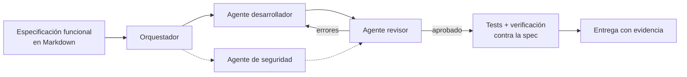

# Portfolio — Lionel Carreras

Casos de proyectos que desarrollé conduciendo agentes de IA. El código es privado porque son productos propios de [Kiersys Technologies](https://kiersys.com) o desarrollos para clientes. Acá está lo que se puede mostrar: el problema, la arquitectura, las decisiones técnicas y los resultados.

## Cómo trabajo

1. **Spec primero.** Cada proyecto arranca con un documento funcional que es la fuente de verdad: entidades, reglas de negocio, contratos de API y criterios de aceptación.
2. **Agentes con roles.** Un orquestador reparte el trabajo entre agentes especializados (backend, frontend, seguridad, revisión) usando Claude y Codex/GPT.
3. **Nada se da por terminado sin evidencia.** El revisor devuelve los errores al desarrollador antes de cada entrega. Yo reviso los cambios, interpreto los fallos y valido el resultado contra lo pedido.

Detalle del método: [entorno multiagente](proyectos/entorno-multiagente.md).

## Proyectos

| | Proyecto | Stack principal | Resultado |
|---|---|---|---|
| 📅 | [AgendAR](proyectos/agendar.md) | Django · PostgreSQL · Celery · WhatsApp Cloud API · Mercado Pago | +1.000 turnos sin intervención |
| 🧾 | [Facturación electrónica ARCA](proyectos/facturacion-arca.md) | Python · PySide6 · FastAPI · SOAP WSFEv1 · SQLite | 16 h/mes de carga manual eliminadas |
| 💬 | [Kiersys AI](proyectos/kiersys-ai.md) | Django · Gemini · pgvector (RAG) · WhatsApp Cloud API | Atención 24/7 con derivación a humanos |
| 🤖 | [Entorno multiagente](proyectos/entorno-multiagente.md) | Claude · Codex/GPT · MCP · SQLite | Método de desarrollo de todos los proyectos |
| 🔐 | [K-Shield](proyectos/k-shield.md) | C++ · C ABI · Python · Node/TS · Rust · Go | SDK con patente en trámite |
| 🖨️ | [SystemPrint](proyectos/systemprint.md) | Telemetría · IoT | Sin visitas técnicas de rutina |
| 🚚 | [Plataforma logística](proyectos/plataforma-logistica.md) | Django · SQL Server · PWA · PHP | Presupuestos de 2 h a segundos |

## Contacto

[LinkedIn](https://www.linkedin.com/in/lionel-carreras) · [kiersys.com](https://kiersys.com) · lionelcarreras.it@gmail.com

Si querés ver alguno funcionando, escribime y coordinamos una demo.
