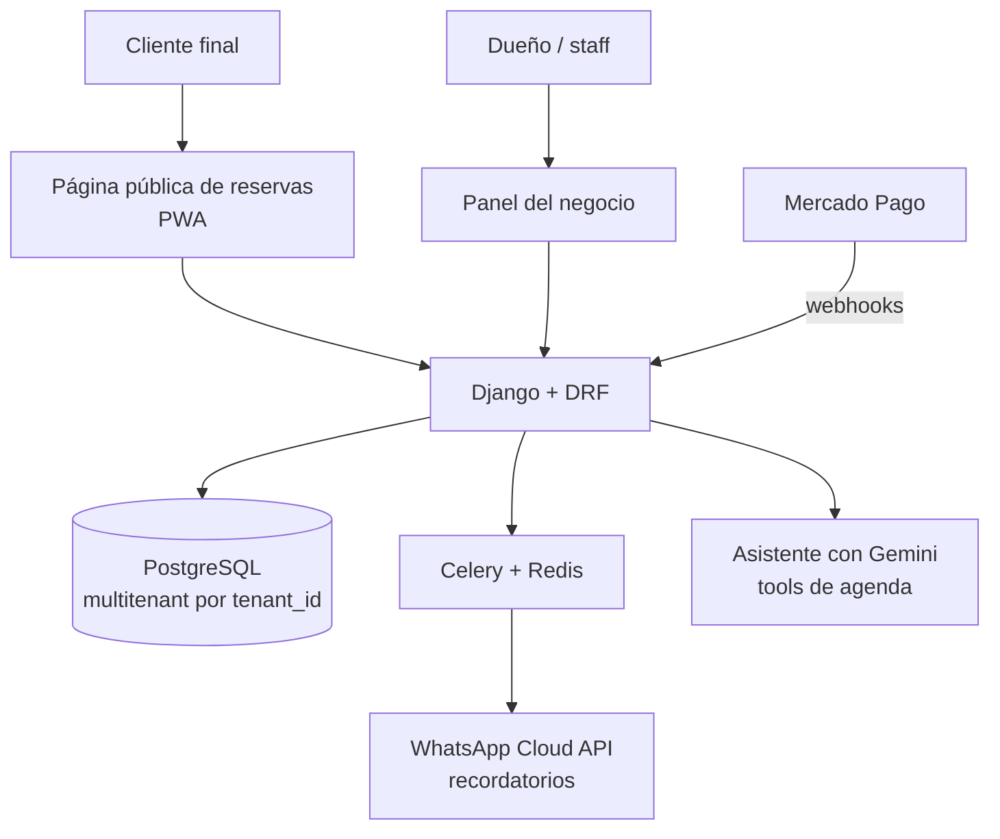

# AgendAR — SaaS de turnos online

[agendar.kiersys.com](https://agendar.kiersys.com) · Producto propio de Kiersys Technologies · En producción

## Problema

Peluquerías, estéticas y consultorios organizan los turnos por WhatsApp o en un cuaderno. Se va tiempo contestando "¿tenés lugar el jueves?" y se pierden turnos porque nadie avisa que no viene.

## Solución

Un SaaS multitenant donde cada negocio tiene su página pública de reservas, un panel para organizar al equipo, recordatorios automáticos por WhatsApp y cobro de señas con Mercado Pago directo a la cuenta del negocio, sin comisión.

## Resultado

- **Más de 1.000 turnos gestionados sin intervención humana.**
- En uso diario por negocios de Rosario.

## Arquitectura

## Decisiones técnicas

- **Multitenancy por columna.** Toda tabla sensible lleva `tenant_id` y hay una regla de aislamiento que verifican los agentes revisores en cada cambio.
- **Disponibilidad con control de concurrencia.** Validación para que dos clientes no reserven el mismo horario a la vez, con tests de concurrencia sobre PostgreSQL.
- **Pagos directos al negocio.** Mercado Pago conectado a la cuenta de cada negocio, sin comisión de la plataforma. Los tokens se guardan cifrados y hay conciliación automática de pagos.
- **WhatsApp asíncrono con cuota.** Los envíos van por Celery con control de cuota por plan, sobre la API oficial de Meta.
- **Planes y permisos.** Planes con límites y capacidades por negocio, más un panel de superadmin.
- **CI con gates.** GitHub Actions con gates de seguridad estática y de artefactos antes del deploy.

## Cómo se construyó con IA

El documento del MVP es la fuente de verdad. Un agente arquitecto valida multitenancy, pagos y WhatsApp contra las secciones de la spec, y agentes especialistas implementan backend, frontend y seguridad. Las reglas críticas están escritas para los agentes: aislamiento multitenant, seguridad de pagos y límites de WhatsApp. Las pruebas E2E son asistidas por IA.

## Stack

Python · Django 5 · Django REST Framework · PostgreSQL · Redis · Celery · React · PWA · WhatsApp Cloud API · Mercado Pago · Gemini · Docker · Nginx · GitHub Actions
