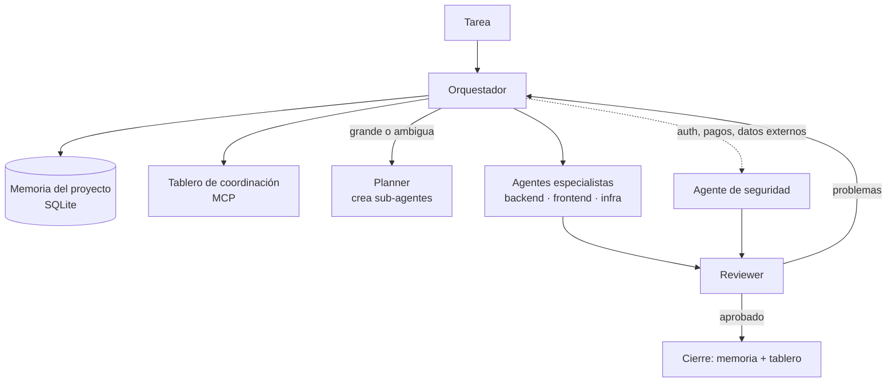

# Entorno multiagente, DUO y Software Factory

Herramientas propias para desarrollar software con agentes de IA

## Entorno multiagente

El método con el que construyo todos los proyectos de este portfolio.

- **El orquestador no escribe código.** Entiende la tarea, consulta la memoria del proyecto, decide qué agentes y skills usar, delega y decide si aprueba, vuelve a delegar o escala.
- **Seguridad en paralelo.** Toda tarea que toca autenticación, APIs, datos o inputs externos activa un agente de seguridad.
- **Revisión obligatoria.** Nada pasa sin el reviewer. Los errores vuelven al agente desarrollador antes de la entrega.
- **Memoria persistente.** Cada sesión empieza leyendo el último estado, los archivos tocados y los próximos pasos, y termina registrándolos.
- **Coordinación entre IAs.** Cuando trabajan Claude y Codex sobre el mismo proyecto, se coordinan con un tablero propio expuesto por MCP. Cada tarea es una tarjeta, se detectan conflictos de archivos entre agentes y el contenido del tablero se trata como input no confiable.
- **Reglas y skills por proyecto.** Por ejemplo, aislamiento multitenant o seguridad de pagos, escritas para que los agentes las verifiquen en cada cambio.

## DUO

Una app que pone a GPT y a Claude en la misma conversación, en modo debate o en revisión cruzada: uno propone y el otro critica. Sirve para decisiones de arquitectura y para revisar código desde dos modelos distintos.

## Software Factory

Agentes autónomos que trabajan a partir de las especificaciones de un proyecto y van desde la spec hasta la entrega verificada, reutilizando el mismo esquema de roles, revisión y memoria.

## Stack

Claude (Claude Code, Claude Desktop) · Codex/GPT · MCP · Python · SQLite
