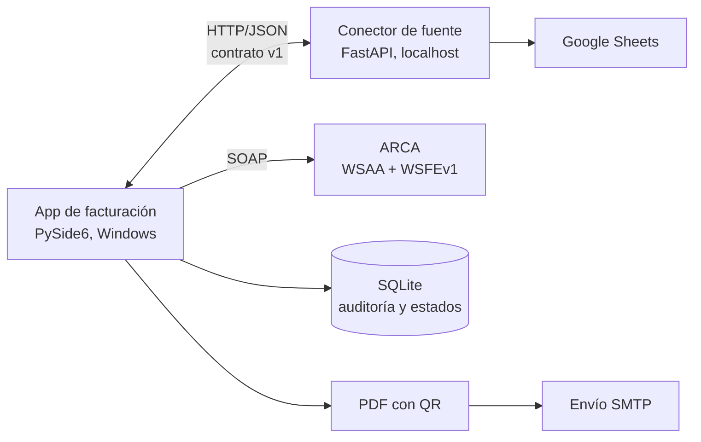

# Facturación electrónica ARCA automatizada

Desarrollo a medida para un negocio de viandas · Kiersys Technologies

## Problema

Los consumos de cada cliente se cargaban en una planilla de Google Sheets y después había que armar y emitir cada factura a mano en ARCA, según la periodicidad de cada cliente, y mandar el PDF por mail.

## Solución

Una aplicación de escritorio para Windows que lee los consumos, arma las facturas que corresponden a cada cliente, las emite en ARCA por web service y envía el comprobante por mail.

## Resultado

- **16 horas mensuales de carga manual eliminadas.**
- Factura A y B con CAE, notas de crédito y comprobante PDF con QR.

## Arquitectura

## Decisiones técnicas

- **El núcleo no sabe de dónde vienen los datos.** Habla con un conector a través de un contrato HTTP fijo. Hoy la fuente es Google Sheets, mañana puede ser un Excel, MySQL o la API de un sistema de gestión, sin tocar la app.
- **Integración ARCA completa.** Autenticación WSAA con firma CMS/PKCS#7, cacheo del ticket de acceso y emisión vía WSFEv1 con CAE.
- **Recuperación ante errores.** Auditoría en SQLite, detección de duplicados y reintento seguro, para que un corte a mitad de la emisión no genere dos facturas.
- **Reglas de facturación sin I/O.** La lógica de periodicidad, corte de mes, tipo A/B y agrupación está aislada y testeada.
- **Decisiones documentadas en ADRs** y empaquetado con PyInstaller + Inno Setup.

## Cómo se construyó con IA

La documentación funcional (alcance, reglas de facturación, contrato del conector, integración con ARCA) se escribió primero y los agentes implementaron módulo por módulo contra esos documentos, con tests en cada capa.

## Stack

Python 3.13 · PySide6 · FastAPI · zeep (SOAP) · cryptography · SQLite · Google Sheets API · SMTP · PyInstaller · pytest
