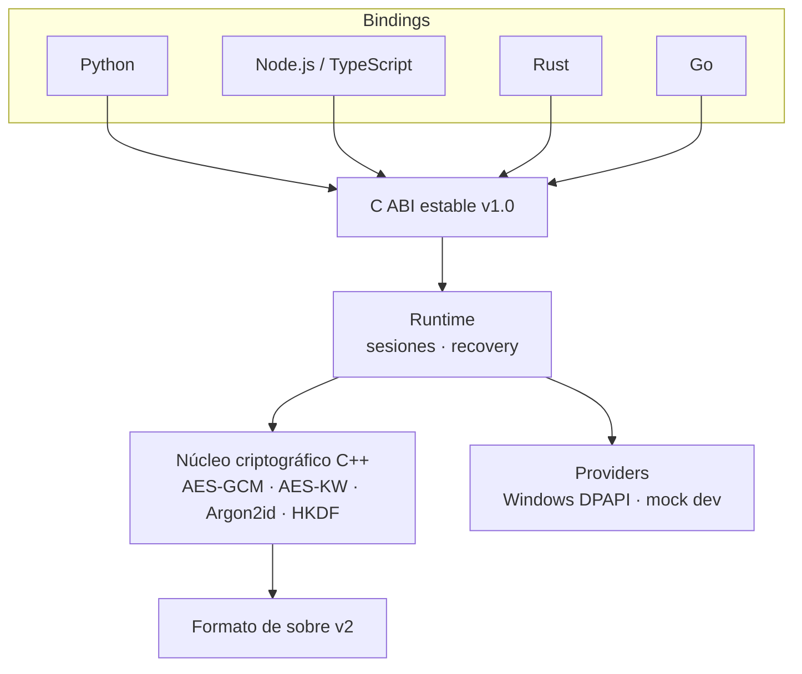

# K-Shield — SDK criptográfico de triple llave

Proyecto propio · Patente en trámite

## Problema

Las aplicaciones guardan contraseñas de bases de datos, API keys y tokens en archivos de configuración o variables de entorno, y los archivos sensibles quedan en disco sin cifrar. Las apps que integran LLMs suman todavía más secretos que proteger.

## Solución

Un SDK nativo de cifrado con dos frentes de uso:

- **Secret Store:** guardar y leer secretos de la aplicación (`put_secret`, `get_secret`, `delete_secret`).
- **File Protection:** cifrar archivos individuales y paquetes de exportación en reposo (`protect_file`, `unprotect_file`).

El esquema de **triple llave** combina software, hardware (TPM / protección del sistema operativo) y usuario, para que ninguna pieza sola alcance para abrir los datos.

## Arquitectura

## Decisiones técnicas

- **Núcleo en C++ con una C ABI estable** y bindings oficiales para Python, Node/TypeScript, Rust y Go, con un wrapper `SecureVault` simple en cada lenguaje.
- **Política fail-closed por provider.** Si el provider de producción no está disponible, el SDK no cae en silencio a un modo inseguro.
- **Diseño documentado en RFCs:** modelo criptográfico y derivación de claves, formato de sobre y matriz de providers.
- **Recuperación** por seed / slot de recuperación (en preview).
- **Validación:** suite de tests en verde en Windows x64, validación externa multilenguaje y checklist de seguridad para releases.

## Stack

C++ · CMake · C ABI · Python · Node.js · TypeScript · Rust · Go · Windows DPAPI · GitHub Actions
