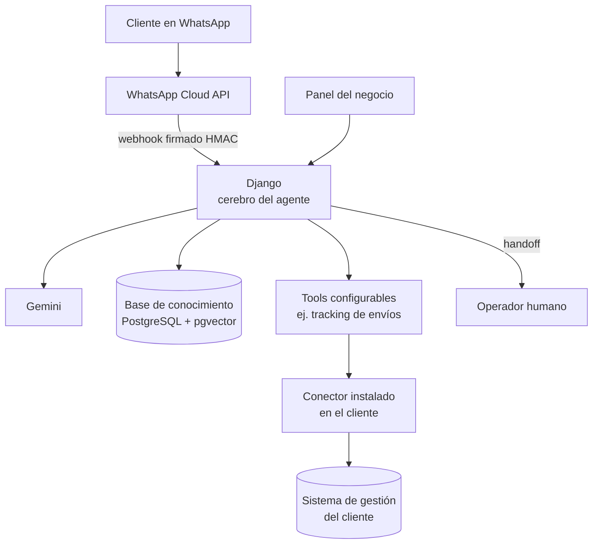

# Kiersys AI — Agentes de IA para WhatsApp

Producto de Kiersys Technologies · Primer caso: Expreso Brío (logística)

## Problema

En una distribuidora, la mayoría de los mensajes son la misma pregunta: "¿dónde está mi pedido?". Alguien abre el sistema, busca el envío, copia el estado y lo pega en WhatsApp, decenas de veces por día. Fuera del horario los mensajes se acumulan.

## Solución

Un agente de WhatsApp conectado a los datos de la empresa que responde con información real, y que pasa la conversación a una persona, con todo el historial, cuando la consulta se sale del libreto.

## Arquitectura

## Decisiones técnicas

- **RAG sobre documentos del negocio.** PDFs, DOCX y textos indexados con embeddings en pgvector, más campos estructurados del negocio: productos, FAQs y reglas.
- **Conector del lado del cliente.** Un servicio liviano que corre en la red del cliente expone solo las consultas declaradas en un manifiesto. El agente obtiene el dato que necesita sin acceder a la base ni a las credenciales.
- **Handoff a humanos.** Se activa por palabras gatillo, baja confianza del modelo o pedido explícito. El operador recibe la conversación completa.
- **Panel configurable por el cliente.** Identidad, personalidad del agente, plantillas de prompt versionadas, productos y FAQs. Roles de admin y operador.
- **Instancias aisladas por cliente** con Docker Compose y un control plane para dar de alta clientes.
- **CI estricta.** Dependencias instaladas con hashes, `pip-audit` que rompe el build ante vulnerabilidades y un piso mínimo de tests por suite.

## Stack

Python · Django · DRF · Google Gemini · pgvector · PostgreSQL · WhatsApp Cloud API · Docker Compose · Caddy · GitHub Actions
