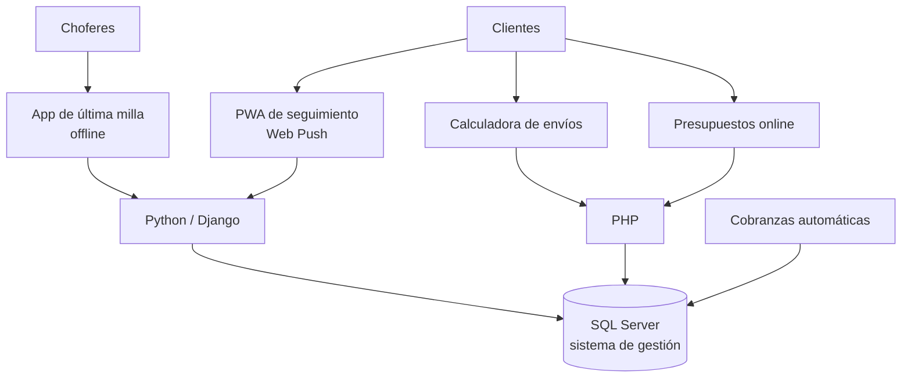

# Plataforma logística — Expreso Brío

Desarrollo interno como Líder de IT · Operación de 30 sucursales y más de 140 usuarios

## Problema

Una empresa de logística con 30 sucursales necesitaba darles visibilidad de sus envíos a los clientes, digitalizar la última milla y sacar de lo manual las cotizaciones y los presupuestos.

## Solución

Un conjunto de aplicaciones a medida integradas con el sistema de gestión de la empresa sobre SQL Server.

- **Seguimiento de envíos:** PWA con consulta en tiempo real y notificaciones Web Push.
- **Última milla:** app para choferes con hojas de ruta, entrega y no entrega, captura de comprobantes y trabajo offline.
- **Calculadora de envíos:** cotizador web público con tarifas en tiempo real ([calculadora.expresobrio.com](https://calculadora.expresobrio.com)).
- **Presupuestos online:** plataforma web integrada con el sistema interno ([presupuestos.expresobrio.com](https://presupuestos.expresobrio.com)).
- **Cobranzas automáticas:** procesamiento de morosos dos veces por semana y reporte ejecutivo.

## Resultados

- **Presupuestos: de 2 horas a segundos**, con carga directa en el sistema.
- **Cobranzas: de 6 días/hombre semanales de trabajo manual a cero.**
- Cotizaciones autónomas para todos los clientes.

## Arquitectura

## Stack

Python · Django · SQL Server · PHP · JavaScript · PWA · Web Push · n8n · Azure · GitHub Actions
